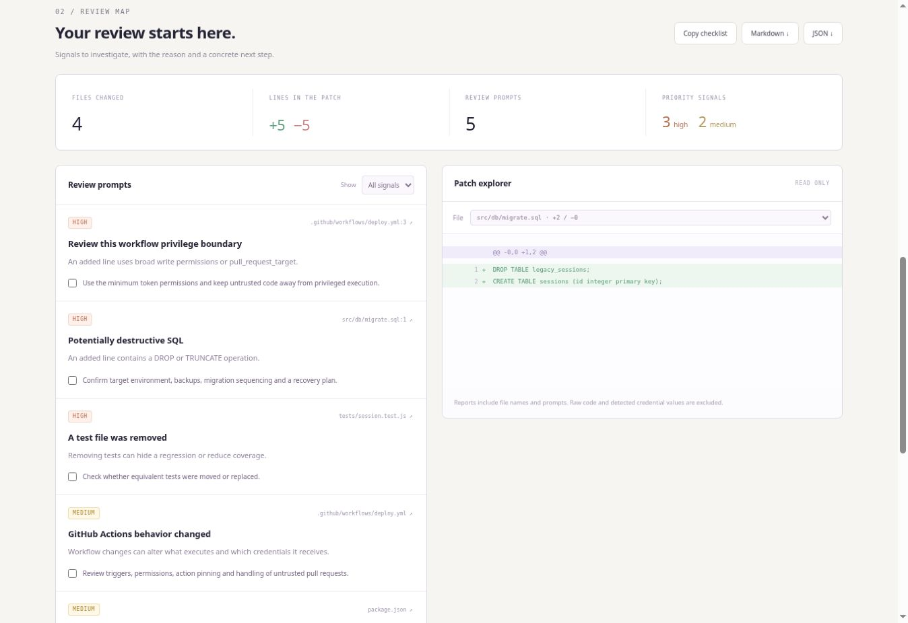

<div align="center">


# PatchScope

### Big diff? Know where to look.

**Turn a Git patch into an actionable review checklist — in your browser, terminal or GitHub Actions.**

[Try the live demo](https://brunnojob.github.io/patchscope/) · [CLI quick start](#cli-quick-start) · [GitHub Actions](#github-actions) · [Contribute a rule](CONTRIBUTING.md)


</div>

---

Reviewing a change is easier when you know where to start. PatchScope reads a unified diff and highlights concrete reasons to take a closer look: removed tests, broad workflow permissions, destructive SQL, dependency changes and more.

Every prompt explains **what matched, why it matters and what to check next**. The same dependency-free engine powers the web app, CLI and reusable GitHub Action.

**No API keys. No model calls. No code uploads. No account.**

## Try it in 30 seconds

1. Open **[PatchScope](https://brunnojob.github.io/patchscope/)**.
2. Click **Explore the example**, or paste `git diff --no-ext-diff --no-color HEAD` output.
3. Filter prompts, inspect changed lines and export a Markdown checklist for your pull request.

The bundled example has **4 changed files and 5 review prompts**. Also try the skipped-test example or a documentation-only patch with no matched rules.



## What it catches

| Signal | Review prompt |
| --- | --- |
| Private-key headers or credential-like literals | Verify values and replace real credentials with secret references |
| `permissions: write-all` or `pull_request_target` | Review the workflow privilege boundary |
| `DROP` or `TRUNCATE` SQL | Confirm environment, backups and recovery |
| Deleted test files | Confirm replacement coverage |
| Skipped or exclusive test markers | Check which tests actually run |
| Known TLS verification bypass patterns | Restore certificate verification |
| Dynamic `eval` / `exec` calls | Trace input and execution context |
| Dependency manifest without a lockfile in the patch | Check the project’s dependency policy |
| Source changes without changed tests | Confirm existing coverage or add a regression test |
| Binary changes or large file changes | Make space for a separate review |

These are **heuristics, not a security audit**. A match can be intentional; no matches do not establish safety. Dependency and test prompts describe the patch, not the whole repository. There is no invented risk percentage or claim that the tool understands an entire application.

## Browser workspace

Paste or drop a patch, explore files with old/new line numbers, filter severity and check off review actions. Copy Markdown or download Markdown/JSON. `Ctrl+Enter` / `Command+Enter` analyzes; **Clear** removes the patch and results from memory.

Patches stay in page memory. The app uses no localStorage, analytics, third-party fonts or remote processing. Reports contain file names, metrics and prompts, **not raw source lines or detected credential values**. File names can themselves be sensitive: inspect reports before sharing. GitHub Pages applies its own infrastructure privacy policies.

Limits: **2 MB, 500 file sections and 60,000 input lines**. The file preview displays at most 1,500 lines; the engine analyzes all supported lines within those limits.

## CLI quick start

Requires Node.js 22+. No `npm install` needed.

```sh
git clone https://github.com/brunnojob/patchscope.git
cd patchscope
npm run demo
node scripts/cli.mjs docs/example.diff --format json
```

Review your own patch:

```sh
git diff --no-ext-diff --no-color HEAD > change.diff
node /path/to/patchscope/scripts/cli.mjs change.diff --format markdown > review.md
```

Or use stdin:

```sh
git diff --no-ext-diff --no-color HEAD | node /path/to/patchscope/scripts/cli.mjs - --format json
```

Exit `0` means analysis completed, even when prompts were found. Invalid/oversized input and missing files exit `1`. This is not a blocking security gate.

## GitHub Actions

The composite action accepts an existing patch, writes a job summary and creates report files. It does not post comments, request an API token, contact an AI service or modify the repository.

```yaml
name: Patch review
on: pull_request
permissions:
  contents: read
jobs:
  review:
    runs-on: ubuntu-latest
    steps:
      - uses: actions/checkout@v4
        with:
          fetch-depth: 0
      - name: Create review patch
        env:
          BASE_SHA: ${{ github.event.pull_request.base.sha }}
          HEAD_SHA: ${{ github.event.pull_request.head.sha }}
        run: git diff --no-ext-diff --no-color "$BASE_SHA...$HEAD_SHA" > review.diff
      - uses: brunnojob/patchscope@main
        id: scope
        with:
          diff-file: review.diff
      - uses: actions/upload-artifact@v4
        with:
          name: patchscope-review
          path: |
            ${{ steps.scope.outputs.report-json }}
            ${{ steps.scope.outputs.report-markdown }}
```

Use `@main` for a first experiment. In production, pin this and other third-party actions to reviewed full commit SHAs. The composite action declares `actions/setup-node@v4` to provide Node.js 22.

| Input / output | Meaning |
| --- | --- |
| `diff-file` | Required path to an existing unified diff |
| `summary` | `true` by default; `false` disables the job summary |
| `report-json` | Output path to the JSON report |
| `report-markdown` | Output path to the Markdown report |
| `high-count` | Output count of high-priority heuristic prompts |

Action summaries and artifacts follow your repository’s access and retention settings. Browser code is not uploaded; your configured workflow can publish its report.

## Why this exists

PatchScope is a small review tool you can inspect, run locally and adapt without an account, backend or model subscription. It helps prepare the human review instead of assigning an opaque score.

If it saves you review time, **[a star helps others find it](https://github.com/brunnojob/patchscope)**. A reproducible edge case or carefully scoped rule is just as useful.

## Development

```sh
npm run dev
npm run check
npm test
```

Open `http://localhost:4173`. ES modules need HTTP; opening the HTML with `file://` is unsupported.

| Module | Responsibility |
| --- | --- |
| `src/engine.js` | Diff parsing, heuristics and Markdown generation |
| `src/app.js` | Browser interactions and downloads |
| `src/examples.js` | Synthetic offline examples |
| `scripts/cli.mjs` | File/stdin CLI |
| `scripts/action.mjs` | Job summary and report outputs |
| `action.yml` | Reusable composite action |
| `tests/` | Parser, rules, report privacy, CLI and Action integration |

Tests cover quoted/UTF-8 names, renames, line numbers, binary changes, deleted tests, placeholder credentials, escaping, limits, stdin and actual output files. CI runs on Linux/Windows with Node.js 22/24 and smoke-tests the composite action.

## Limits and next steps

Recognizes unified text diffs and basic Git file metadata. Combined merge diffs, AST analysis, full secret scanning and whole-repository context are outside this version. Comments, multiline constructs, unusual languages and test-file naming conventions can produce false negatives. Binary content is not inspected.

Planned: configurable rules, suppression explanations, additional parser fixtures and SARIF export. These are not implemented yet.

## Credits and license

Created by **[brunnodev](https://brunnodev.store)** on **[brunnojob](https://github.com/brunnojob)**. MIT licensed; see [LICENSE](LICENSE).
